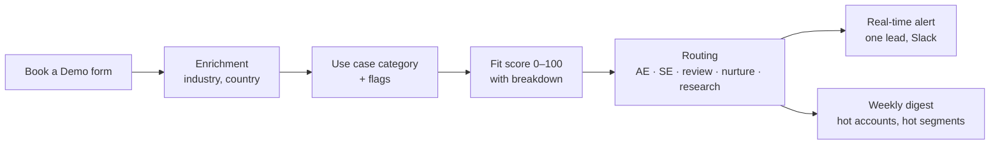

# Inbound lead engine for Prior Labs — v1

A v1 of an inbound lead engine for Prior Labs: rule-based scoring and routing that works from day one, plus a benchmark showing where TabPFN adds value once real deal history exists.

## The assumptions behind the rules

Built from public information (website, demo form, customer stories), not from Prior Labs' data. Each one is a hypothesis to test against real deals.

- **Commercial use may be the strongest buying signal.** A free user running TabPFN on real work with a company email is likely to need a commercial license, so it gets its own alert.
- **The person booking a demo may not be the buyer.** It is often a hands-on data scientist, so company, usage and use case weigh more than seniority (seniority adds no points).
- **Several people from one company may signal a deal forming.** When technical users and a senior person from the same company sign up within days, the deal may be moving to decision-makers.

## How it works



Three design choices behind it:

1. **Rules first, model later.** With no won/lost history (cold start), a model has nothing to learn from. Rules work from day one, every score shows its breakdown, and TabPFN is added once real outcomes exist.
2. **Business decisions live in one file.** Every weight, keyword and threshold is in `config.py`, so recalibrating means changing a number, not code.
3. **One lead vs all leads.** Scoring needs only the lead itself, so it can run the moment the form is submitted (`new_lead.py`). Hot accounts and trends need history, so they also run as a weekly batch (`main.py`).

```
config.py            all rules and weights
src/classify.py      use case category + flags
src/fit_score.py     0–100 score with breakdown
src/routing.py       who handles the lead
src/patterns.py      hot accounts, hot segments
src/alerts.py        alert text, Slack
src/new_lead.py      real-time: one new lead
src/main.py          batch: all leads + weekly digest
src/compare_models.py  TabPFN benchmark
```

## The fit score

| Signal | Points |
|---|---|
| Tried TabPFN | already using 25 · tried a few times 18 · just exploring 10 · not yet 5 |
| Industry | finance 15 · healthcare / pharma / biotech 12 · industrials 12 · energy, tech, retail, logistics 8 · other 5 |
| Company size | 1000+ 20 · 250–999 15 · 50–249 8 · 1–49 4 (under 250: only with a target use case) |
| Role | technical / data 20 · business (product, innovation, CTO…) 15 · other 5 |
| Use case | target category 20 · generic tabular prediction 10 · other or not provided 0 |
| Personal email (Gmail etc.) | −25 |

The ranking of each signal comes from research on Prior Labs' public customers and demo form; the exact weights are starting assumptions, built to be recalibrated against real won/lost deals.

**Use case categories:** a starting set, built from the use cases on Prior Labs' industry pages.

| Category | Example keywords |
|---|---|
| fraud | fraud, money laundering, chargeback |
| risk / credit | credit, loan, mortgage, claim |
| anomaly / maintenance / quality | predictive maintenance, defect, outage |
| clinical / pharma | patient, biomarker, drug discovery, genomic |
| churn | churn, attrition, cancel |
| forecasting | forecast, demand, volatility, trading |
| customer / commercial | cross-sell, lifetime value, lead scoring, pricing |
| operations / supply chain | supply chain, inventory, supplier, route |

**Routing** (first match wins): students → nurture; academics → research/community, not scored; consultancies with a target use case → AE; already using TabPFN at a company → AE (250+) or SE; then score ≥75 → AE, <40 → nurture, otherwise sales review.

In production, the Account Executive threshold should come from sales capacity: if the team can take N demos a week, the threshold is the score that separates the top N leads.

## Example output

```
🏢 HOT ACCOUNT — Buying group forming   (2026-09-30)
Company: Altmark Insurance AG (finance, 1000+, Germany → Berlin team)
People: 3 sign-ups in 9 days: Data Scientist, Head of Analytics, Risk Analyst
Why: 3 people signed up within 9 days: a team is actively testing. Technical users AND a senior/business person: the deal is moving to decision-makers.
Next step: Account Executive (Berlin team): map the account and propose a team demo, bring the senior contact in.
```

Score breakdown (Quantitative Analyst, Thames Mutual, "PD/LGD models for IFRS 9"):
`tried 18 + industry 15 + size 20 + role 20 + use case 20 = 93 → Account Executive`

## The TabPFN benchmark

The fake leads have no outcomes, so TabPFN was tested on 9,240 real public leads (Kaggle "Lead Scoring Dataset", 39% converted), using only fields known at sign-up. ROC-AUC: 1.0 = perfect ranking, 0.5 = random.

| Training leads | TabPFN | Gradient boosting | Logistic regression |
|---|---|---|---|
| 100 | **0.803** | 0.784 | 0.768 |
| 500 | **0.852** | 0.831 | 0.809 |
| 7,392 | **0.869** | 0.859 | 0.827 |

In one test, TabPFN ranked leads better than two standard methods at every data size, with a larger margin when data was small (100–500 leads) than large. This is one dataset and one split; it would need repeated testing to confirm.

## What I'd do in the first month with your real data

- Join CRM outcomes (won/lost) with API usage data.
- Add TabPFN's conversion probability next to the rule-based fit score.
- Check which signals actually predicted won deals, and recalibrate the weights.
- Track which entry point each won deal came from (demo form, API sign-up, community, outbound).

## Build vs buy

HubSpot and Salesforce already score and route leads, and in production the rules should live there, not in a separate script. What a CRM doesn't give you is the judgment on *which* signals matter for Prior Labs, and a TabPFN layer trained on your own deals. That is what this v1 is for.

## Limits of this v1

- **Fake data:** the leads are invented, and patterns (hot accounts, a hot segment) are planted to show detection working.
- **Benchmark:** a public B2C dataset (online courses), not B2B enterprise sales; one split only.
- **TabPFN is not wired into the engine:** scoring is rule-based.
- **Weights are unvalidated:** starting assumptions until real won/lost deals exist.
- **Batch, not live:** `main.py` recomputes everything from a CSV; `new_lead.py` shows the real-time path but isn't connected to the form.
- **No memory of alerts sent:** running twice sends the same alerts twice.
- **Keyword matching:** English only, and it misses unknown wording (e.g. German "Kreditrisiko" or "Betrugserkennung"). LLM classification would fix this.
- **Categories are a starting set:** user engagement, feature adoption and synthetic data generation fall into "generic" or "other".

## How to run it

Python 3.10+.

```
pip install -r requirements.txt
python src/main.py                                  # all leads: scores, alerts, weekly digest
python src/new_lead.py                              # one new lead: completes a hot account
python src/new_lead.py data/examples/hot_lead.json  # one new lead: hot lead alert
python tests/run_test_cases.py                      # 7 test leads
```

Outputs go to `outputs/`: `scored_leads.csv`, `alerts.md`, `weekly_digest.md`. Alerts go to Slack if `SLACK_WEBHOOK_URL` is set in `.env` (copy `.env.example`); otherwise they print on screen.

Benchmark: put the Kaggle "Lead Scoring Dataset" CSV in `data/raw/`, add `TABPFN_TOKEN` to `.env`, then run `python src/compare_models.py`.
